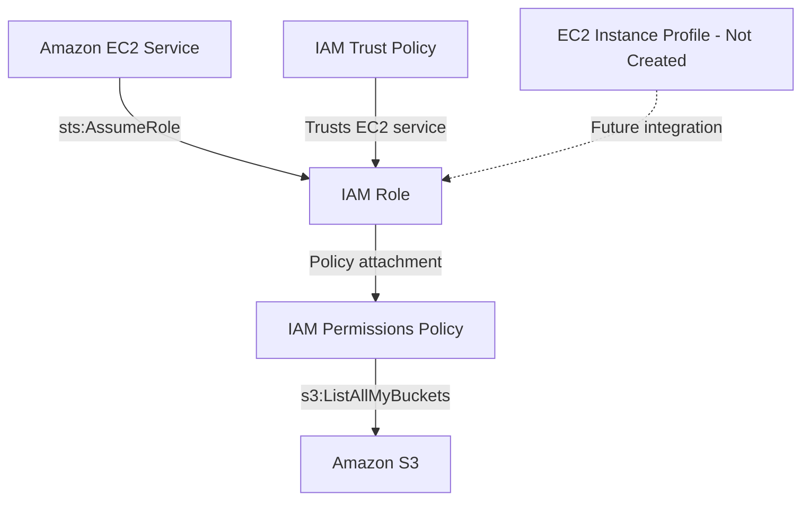
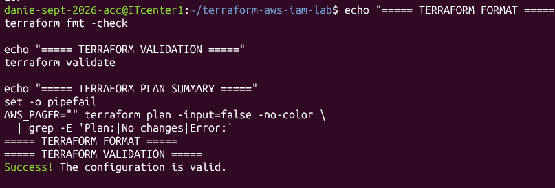

# AWS IAM Least-Privilege Terraform Lab

## Project Overview

This project demonstrates how to design AWS Identity and
Access Management (IAM) resources using Terraform.

The lab creates a Terraform plan for an IAM role,
a customer-managed IAM policy, and a policy attachment.

**Deployment status: PLANNED ONLY — NOT DEPLOYED**

## Architecture



## Planned AWS Resources

| Resource | Count |
|---|---:|
| IAM role | 1 |
| Customer-managed IAM policy | 1 |
| IAM role policy attachment | 1 |
| **Total** | **3** |

## IAM Role

Role name:

terraform-iam-lab-ec2-s3-list-role

Trusted service:

ec2.amazonaws.com

Trust action:

sts:AssumeRole

## IAM Permissions Policy

Policy name:

terraform-iam-lab-s3-list-policy

Allowed action:

s3:ListAllMyBuckets

Resource:

*

The wildcard is appropriate because ListAllMyBuckets
does not support resource-level permissions.

The policy does not grant GetObject, PutObject,
DeleteObject, or administrator permissions.

## Security Design

- Uses a dedicated IAM role.
- Uses a customer-managed IAM policy.
- Grants only the required S3 listing action.
- Separates the trust policy from the permissions policy.
- Does not create access keys.
- Does not modify existing IAM users or roles.
- Does not create an EC2 instance profile.

Additional policies, permission boundaries, and
organization controls can affect effective permissions.

## Tools

- Ubuntu Linux (WSL2)
- AWS CLI
- Terraform
- Git and GitHub

## Terraform Validation

Commands:

```bash
terraform fmt -check
terraform validate
terraform plan -input=false -no-color
```

Verified results:

- Terraform formatting passed.
- Terraform validation passed.
- Plan: 3 to add, 0 to change, 0 to destroy.

See [Validation Evidence](docs/validation-evidence.md).

## Deployment Status

No terraform apply has been executed.

No IAM role, policy, or policy attachment has
been created through this Terraform project.

## Cost and Security

IAM roles and policies generally have no direct
additional IAM charge.

Other AWS services used with IAM may incur charges.

Never commit AWS credentials, private keys,
Terraform state, or sensitive variable files.

## Future Improvements

- Add an EC2 instance profile.
- Demonstrate IAM policy simulation.
- Explore Attribute-Based Access Control (ABAC).
- Explore permissions boundaries.
- Integrate IAM with AWS Systems Manager.
- Add automated security checks.

## Actual Validation Screenshot


