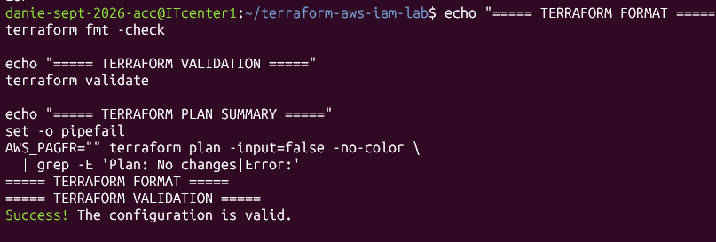

# AWS IAM Terraform Validation Evidence

## Status

PLANNED ONLY — NOT DEPLOYED

## Environment

- Ubuntu Linux (WSL2)
- Terraform v1.17.0
- AWS provider region: us-east-1
- AWS CLI

IAM is a global AWS service.

## Verified Results

terraform fmt -check:
Passed.

terraform validate:
Success! The configuration is valid.

terraform plan:
Plan: 3 to add, 0 to change, 0 to destroy.

## Planned AWS Resources

1. IAM role
2. Customer-managed IAM policy
3. IAM role policy attachment

## Security Validation

Planned IAM permission:

s3:ListAllMyBuckets

Trusted AWS service:

ec2.amazonaws.com

No administrator permission is defined in the lab policy.

## Deployment Status

No terraform apply executed.

No IAM resources deployed through this project.

## Screenshot

Screenshot must contain real terminal validation evidence.
